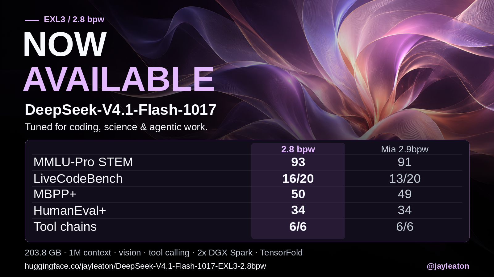

Upstream updates: https://x.com/jayleaton

Support the upstream maintainer: https://buymeacoffee.com/jayleaton

# DeepSeek-V4.1-Flash-1017 on TensorFold, 2x NVIDIA DGX Spark



A recipe for serving DeepSeek-V4.1-Flash-1017 on two NVIDIA DGX Sparks behind an OpenAI-compatible API. It ships
our EXL3 pack (**flash17**) and the TensorFold Zig engine that serves it, with the exact serving profile we measured.

| | |
| --- | --- |
| Model | [`deepseek-ai/DeepSeek-V4.1-Flash-1017`](https://huggingface.co/deepseek-ai/DeepSeek-V4.1-Flash-1017) |
| Pack | **EXL3 2.8 bpw, 203.8 GB**: [`jayleaton/DeepSeek-V4.1-Flash-1017-EXL3-2.8bpw`](https://huggingface.co/jayleaton/DeepSeek-V4.1-Flash-1017-EXL3-2.8bpw) |
| Hardware | 2x DGX Spark (GB10, 128 GB each), tensor parallel 2 over the 200 Gb/s CX7 link |
| Engine | TensorFold Zig, CUDA port `9131e10a` (source in [`engine/zig`](engine/zig)) |
| Serving | 1M context, four slots, vision (native image input), tool calling, structured output |

This fork defaults to the model alias `deepseek-v41-flash` on `127.0.0.1:8100`.

> **Work in progress.** Measured on one pair of Sparks. Read [what is not solved](docs/KNOWN-ISSUES.md) before
> relying on it.

## Fork additions

This fork starts from [upstream PR65](https://github.com/jayleaton/deepseek-v41-tensorfold-spark/pull/65),
commit `207273b261196ee491b06e5818031ff54f91fcee`, and adds:

- A two-node lifecycle script, [`scripts/zig-stack.sh`](scripts/zig-stack.sh), with Docker
  `unless-stopped` restart policies and a configurable model alias.
- Native `/health` and `/metrics` compatibility with EngineMetrics: actual stream progress, shared-pool
  occupancy, retained snapshots and per-rank SSD-session statistics.
- Immediate SSD persistence without dropping the RAM copy, and common-prefix recovery after restart.
- A complete [flash17 example](config/prod-zig-flash17.env.example): four slots, 1M context,
  a 2.1M shared pool, 4K prefill and 32 GiB SSD cache per node. Its explicit 1 GiB memory floors are
  less conservative than the upstream defaults; they are an operator choice, not a universal safety guarantee.

For an EngineMetrics checkout that discards the gauges its display uses, apply
[`tools/enginemetrics-gauges.patch`](tools/enginemetrics-gauges.patch) from that checkout:

```bash
git apply --check /path/to/this-repo/tools/enginemetrics-gauges.patch
git apply /path/to/this-repo/tools/enginemetrics-gauges.patch
```

An already-fixed adapter does not need the patch. Local settings, model data, caches and run logs are excluded
from the repository. The results below are inherited upstream measurements, not new benchmarks of this fork.

## Upstream results

**Tasks.** 356 matched items (pass@1, greedy, thinking on, effort high), against Mia-AiLab's 2.9 bpw pack and
our previous q28-v2 pack:

| Suite | flash17 | Mia 2.9 bpw | q28-v2 |
| --- | ---: | ---: | ---: |
| HumanEval+ | 34 / 40 | 34 / 40 | 33 / 40 |
| MBPP+ | 50 / 60 | 49 / 60 | 50 / 60 |
| MMLU-Pro STEM | 93 / 100 | 91 / 100 | 90 / 100 |
| MATH-500 | 36 / 40 | 36 / 40 | 36 / 40 |
| SciCode (first step) | 6 / 10 | 6 / 10 | 5 / 10 |
| LiveCodeBench | 16 / 20 | 13 / 20 | 13 / 20 |
| BFCL | 39 / 40 | 39 / 40 | 39 / 40 |
| Tool chains | 6 / 6 | 6 / 6 | 4 / 6 |
| MGSM | 40 / 40 | 40 / 40 | 40 / 40 |

Small samples: every paired 95 % confidence interval includes zero, so these show no statistically significant
difference. Intervals, method and limits are in [FLASH-1017](docs/FLASH-1017.md#task-results-356-items).

**Retention of the 1017 release, as served** (top-1 agreement with the release, with the serving expert pruning):
code **95.17 %**, science **94.93 %**, tools **87.64 %**. The full table, with KL and the other packs:
[FLASH-1017](docs/FLASH-1017.md#fidelity-to-the-release-retention-as-served).

**Speed** at the recommended profile (2.1M pool, 2100 MHz cap), single stream: short decode **87.9 tok/s**; decode
after a 32K / 131K prompt 64.1 / 64.9 tok/s; prompt tokens over time to first token 2,349 / 2,198 tok/s (TTFT includes
HTTP and admission). q28-v2's earlier measurements, under a different clock and its 3.0M pool, were 85.75, 66.7 / 64.5
and 2,630 / 2,460; not a matched A/B. Details: [FLASH-1017](docs/FLASH-1017.md#speed).

**Images and agents** at the recommended profile: VQA 20 / 20 plus 3 / 3 `image_url` probes; a clean OpenCode
session passed (7 valid tool calls, normal stop).

## Quick start

The full guide is [ZIG-SERVE](docs/ZIG-SERVE.md). Build the image and the per-rank assets as it describes, then:

```bash
git clone --recurse-submodules https://github.com/0rand/deepseek-v41-tensorfold-spark.git
cd deepseek-v41-tensorfold-spark
hf download jayleaton/DeepSeek-V4.1-Flash-1017-EXL3-2.8bpw --local-dir /srv/models/flash17   # both nodes
cp config/prod-zig-flash17.env.example config/prod-zig.env && $EDITOR config/prod-zig.env    # both nodes
scripts/zig-stack.sh start
scripts/zig-stack.sh status
# scripts/zig-stack.sh stop
```

- Replace the documentation IPs, SSH user, node paths and NIC/HCA names in
  [`config/prod-zig-flash17.env.example`](config/prod-zig-flash17.env.example) with your own values.
  Configure both ranks before starting. Initial image and AOT preparation are separate from routine starts;
  do the coverage check in [ZIG-SERVE](docs/ZIG-SERVE.md) when generating assets or changing kernel shapes.
- Pack the **1017 Engram shards** with `scripts/pack_engram.py` ([INSTALL step 3](docs/INSTALL.md), with
  `deepseek-ai/DeepSeek-V4.1-Flash-1017` as the source); the September shards do not match this pack.
- We suggest a 2100-2200 MHz GPU clock cap (`nvidia-smi -lgc 300,2100`) to help with temperature control.
- Check the answer to `What is 17 * 23?` is 391 before serving traffic.

## Rollback to q28-v2

The previous pack, q28-v2
([`jayleaton/DeepSeek-V4.1-Flash-EXL3-2.8bpw`](https://huggingface.co/jayleaton/DeepSeek-V4.1-Flash-EXL3-2.8bpw)),
keeps its own unchanged profile, [`config/prod-zig.env.example`](config/prod-zig.env.example) (September Engram shards,
3.0M pool). Stop rank 0, then start both ranks with that config:
[FLASH-1017, rollback](docs/FLASH-1017.md#rollback-to-q28-v2). Its measurements are in
[PREVIOUS-RESULTS](docs/PREVIOUS-RESULTS.md).

The earlier Python recipe (TensorFold 0.6.0 plus three patches, with its original 2.9 bpw pack) is still documented
in [INSTALL](docs/INSTALL.md).

## Documentation

| | |
| --- | --- |
| [FLASH-1017](docs/FLASH-1017.md) | the flash17 pack: profile, memory, task results, retention, rollback |
| [ZIG-SERVE](docs/ZIG-SERVE.md) / [ZIG-RESULTS](docs/ZIG-RESULTS.md) | Zig build, TP=2 launch, exact settings, q28-v2 comparisons |
| [PREVIOUS-RESULTS](docs/PREVIOUS-RESULTS.md) | q28-v2 kit results and the historical 2.9 bpw Python vs vLLM tables |
| [INSTALL](docs/INSTALL.md) | requirements, weights, Engram shards, the Python recipe, watchdog |
| [API](docs/API.md) / [IMAGES](docs/IMAGES.md) | endpoints, thinking and effort, image input |
| [OPERATIONS](docs/OPERATIONS.md) | settings, memory gates, turning each lever off |
| [METHOD](docs/METHOD.md) / [RESULTS](docs/RESULTS.md) / [BENCHMARKS](docs/BENCHMARKS.md) | how it was measured, every table, how to rerun |
| [CHANGELOG](docs/CHANGELOG.md) | bug fixes and new levers since G13 |
| [KNOWN-ISSUES](docs/KNOWN-ISSUES.md) | what is not solved |
| [PROJECT](docs/PROJECT.md) / [ENGINE](docs/ENGINE.md) / [ARCHITECTURE](docs/ARCHITECTURE.md) / [DECODE](docs/DECODE.md) | patches, layout, model split, decode roofline |
| [campaign/](docs/campaign/README.md) | the development log, windows G1-G19 |

## Credits

Built on [TensorFold](https://github.com/ashhart/TensorFold) by Ash Hart (ashhart), and on
[DeepSeek](https://huggingface.co/deepseek-ai/DeepSeek-V4.1-Flash-1017)'s model, papers and code. Measured against
Mia / MiaAI-Lab's [2x DGX Spark kit](https://github.com/MiaAI-Lab/DeepSeek-v4.1-Flash-EXL3-2x-DGX-Sparks) and
[2.9 bpw pack](https://huggingface.co/Mia-AiLab/DeepSeek-V4.1-Flash-EXL3-2.9bpw). EXL3 is by
[turboderp / ExLlamaV3](https://github.com/turboderp-org/exllamav3). Every contributor, project and benchmark we used
is credited in [CREDITS](docs/CREDITS.md).

## Licensing

This project's code, patches, scripts, benchmarks and docs: **Apache License 2.0** ([`LICENSE`](LICENSE),
[`NOTICE`](NOTICE)). TensorFold, the added files, the adapted kernels, the base image and the model weights each keep
their own terms: [`docs/LICENSING.md`](docs/LICENSING.md).
