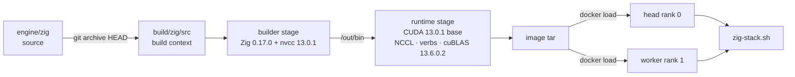

# START HERE

Hands-on path from a clean checkout to a running two-rank Zig stack. This page covers the tool set, host install,
host compile, image build, image transfer and the rebuild loop. The full serving reference is
[docs/ZIG-SERVE.md](docs/ZIG-SERVE.md); the pack is [docs/FLASH-1017.md](docs/FLASH-1017.md).

Commands run from the repo root unless a `cd` says otherwise. `$WORKER_SSH` is the head's BatchMode SSH target
(`WORKER_SSH` in `config/prod-zig.env`).

## 0. What you are building



- `engine/zig` — TensorFold Zig CUDA engine source export (Apache-2.0, provenance in
  [`engine/zig/SOURCE-EXPORT.md`](engine/zig/SOURCE-EXPORT.md)).
- `docker/zig/Dockerfile` — multi-stage image. The builder downloads Zig, compiles the engine and the sm_121
  kernels; the runtime ships `tensorfold-dsv41` and `tf-dsv41-m1` plus the pinned shared libraries.
- `scripts/` — lifecycle, launcher, image check, Engram packer.
- `config/prod-zig-flash17.env.example` — the recommended flash17 serving profile.

## 1. Host prerequisites (both nodes)

### Source checkout

```bash
git clone --recurse-submodules https://github.com/0rand/deepseek-v41-tensorfold-spark.git
cd deepseek-v41-tensorfold-spark
```

`vendor/TensorFold` is a submodule; the asset step uses its Python reference source.

| Component | Version | Why |
| --- | --- | --- |
| Linux ARM64 (DGX Spark GB10) | — | the image is `linux/arm64` |
| Docker Engine + NVIDIA Container Toolkit | current | build and run with `--gpus all` |
| CX7 / RoCE stack | — | TP=2 transport; `/dev/infiniband` and `ibv_devinfo` must work |
| CUDA devel / runtime images | 13.0.1 | Dockerfile defaults (`CUDA_DEVEL`, `CUDA_RUNTIME`) |
| cuBLAS / cuBLASLt | 13.6.0.2 | pinned by the image's `libproof` step |
| NCCL | CUDA repo `libnccl2` (2.32.3 in the validated build) | TP transport |
| SSH | BatchMode head → worker | `zig-stack.sh` and image transfer |
| Disk | ≈450 GiB free per node | 426 GiB of data (204 GB weights + 95 GiB Engram + 95 GiB prepared + 32 GiB sessions) plus build space |
| Network | ziglang.org, nvcr.io, huggingface.co | builder download, base images, weights |

Verify Docker and the GPU runtime:

```bash
docker run --rm --gpus all nvcr.io/nvidia/cuda:13.0.1-base-ubuntu24.04 nvidia-smi
```

Verify the link and SSH:

```bash
ibv_devinfo -d mlx5_0          # port state and link layer
ls /dev/infiniband
ssh -o BatchMode=yes "$WORKER_SSH" true
```

Set `NCCL_SOCKET_IFNAME` and `NCCL_IB_HCA` in the config to your own interface and HCA names; the example uses
`rdma0` / `mlx5_0`.

## 2. Build-host toolchain (the head is enough)

The image build downloads its own Zig inside the builder stage. The host Zig is only for `zig build` and the host
tests.

```bash
sudo mkdir -p /opt/zig
curl -fsSL https://ziglang.org/download/0.17.0/zig-aarch64-linux-0.17.0.tar.xz \
  | sudo tar -xJ -C /opt/zig --strip-components=1
export PATH=/opt/zig:$PATH
zig version                    # 0.17.0
```

Add `/opt/zig` to `PATH` in your shell profile. The version is pinned by [`engine/zig/.zig-version`](engine/zig/.zig-version).

Asset generation needs a GPU-capable ARM64 Python environment with Torch, Triton **3.7.1** and ptxas **13.3.73**.
The vendor's CUDA guidance is the NGC PyTorch container:

```bash
docker run -it --gpus all --ipc=host --network host \
  -v "$PWD:/work" -w /work nvcr.io/nvidia/pytorch:26.07-py3
python -m pip install 'triton==3.7.1' 'nvidia-cuda-nvcc==13.3.73'
export TRITON_PTXAS_PATH=/usr/local/cuda/bin/ptxas          # must report 13.3.73
export TRITON_PTXAS_BLACKWELL_PATH="$TRITON_PTXAS_PATH"
```

Weights download uses the Hugging Face CLI (`hf`) on both nodes:

```bash
curl -LsSf https://hf.co/cli/install.sh | bash -s
hf --help
```

## 3. The tool set

| Tool | What it does | When |
| --- | --- | --- |
| `scripts/zig-stack.sh` | two-rank lifecycle from the head: `start`, `stop`, `restart`, `sync-config`, `status`, `logs` | daily operation |
| `scripts/run-zig.sh` | one local rank; foreground by default, `--detach`, `--dry-run`, `--check-aot` | debugging, AOT coverage |
| `scripts/check-zig-image.sh` | checks NCCL, verbs/mlx5 and the cuBLAS pins in an image | after build or load |
| `scripts/pack_engram.py` | packs `engram-l{1,14}-r{rank}of2.bin` from the source checkpoint | once per pack and rank |
| `scripts/canary.py` | post-start probes: chat, thinking, tool call, schema, tokenize | after start |
| `scripts/check-public.sh` | publication/privacy check | before publishing |
| `engine/zig/tools/zig/dsv41_m2c2/build-kit.sh` | builds the Spark kit (binaries, fatbins, tools) | producing a kit |
| `engine/zig/tools/zig/dsv41_m2c2/kit-fatbins.sh` | builds the sm_121 fatbin directory | prebuilt kernels |
| `engine/zig/tools/zig/triton_fill.py` | `sigs` and `compile` for the Triton AOT set | asset generation |
| `engine/zig/tools/zig/dsv41_rope_tables.py` | writes `rope.bin` | asset generation |
| `engine/zig/tools/zig/dsv41_engram_host.py` | writes `engram-host.bin` | asset generation |
| `engine/zig/tools/zig/lean_check.py` | lean source check (600 lines, 120 columns) | before commit |
| `docker/zig/Dockerfile` | the Zig serving image | image build |
| `config/prod-zig-flash17.env.example` | recommended flash17 profile | config |
| `config/prod-zig.env.example` | q28-v2 rollback profile | config |

`scripts/serve.sh` and `scripts/prebuild_ext.py` belong to the older Python 0.6.0 path, not the Zig engine.

## 4. Compile the engine (host)

```bash
cd engine/zig
zig build                  # host build; embeds empty GPU images
zig build test             # host suite, includes test-dsv41
zig build test-dsv41       # DeepSeek-V4.1 host tests only
python3 tools/zig/lean_check.py
```

`zig build` writes `zig-out/` and `.zig-cache/`; both are ignored. A host build does not prove a GPU or checkpoint
gate — it only proves the host code compiles and its tests pass.

## 5. Build the Zig image

### 5.1 Export the build context

`build/zig` is the Docker context: `src/` is the engine tree, `fatbins/` holds optional prebuilt sm_121 kernels.
It is ignored by git.

```bash
rm -rf build/zig/src
mkdir -p build/zig/src build/zig/fatbins
git archive HEAD engine/zig | tar -x --strip-components=2 -C build/zig/src/
touch build/zig/fatbins/.keep
```

`git archive HEAD` includes only committed files. To build uncommitted work, copy the tree instead:

```bash
rsync -a --delete --exclude .zig-cache --exclude zig-out --exclude /build \
  engine/zig/ build/zig/src/
```

Optional: copy validated `dsv41_*.fatbin` files and `tp_mailbox.fatbin` into `build/zig/fatbins/`. With an empty
`fatbins/`, the builder compiles `mailbox.cu` with nvcc and the Zig build compiles the kernels with nvcc — the
validated `pr65-guard2k` image was built this way (`cuda_13.0.r13.0/compiler.36424714_0`).

### 5.2 Build

```bash
docker build -f docker/zig/Dockerfile \
  --build-arg ZIG_COMMIT="$(git rev-parse HEAD)" \
  -t tensorfold-dsv41-zig:local build/zig
```

Useful build args: `CUDA_DEVEL` / `CUDA_RUNTIME` (match prebuilt fatbins), `ZIG_URL` (mirror), `ZIG_VERSION`,
`ZIG_TARGET`, `ZIG_CPU`. The runtime stage installs cuBLAS / cuBLASLt 13.6.0.2 and ends with `LIBPROOF PASS`.

### 5.3 Check

```bash
scripts/check-zig-image.sh tensorfold-dsv41-zig:local
```

Expected: `check-zig-image: OK`. A missing NCCL, verbs provider, mlx5 provider or a different cuBLAS fails the
check; do not ship the image.

### 5.4 Ship to the worker

```bash
docker save tensorfold-dsv41-zig:local | ssh -o BatchMode=yes "$WORKER_SSH" docker load
```

Offline alternative:

```bash
docker save tensorfold-dsv41-zig:local -o build/zig-image.tar
scp build/zig-image.tar "$WORKER_SSH":/tmp/zig-image.tar
ssh "$WORKER_SSH" 'docker load -i /tmp/zig-image.tar'
```

Compare the image IDs; they must match exactly:

```bash
docker image inspect -f '{{.Id}}' tensorfold-dsv41-zig:local
ssh -o BatchMode=yes "$WORKER_SSH" "docker image inspect -f '{{.Id}}' tensorfold-dsv41-zig:local"
```

### 5.5 Record it in the config

`config/prod-zig.env` is ignored by git. Set `IMAGE` and `ZIG_COMMIT` to the tag and label you built:

```bash
cp config/prod-zig-flash17.env.example config/prod-zig.env
$EDITOR config/prod-zig.env
# IMAGE=tensorfold-dsv41-zig:local
# ZIG_COMMIT=<the commit or local tag recorded in the image label>
```

## 6. Runtime assets (before the first serve)

The image contains binaries, not weights or generated assets. On each rank:

1. **Weights** — `hf download jayleaton/DeepSeek-V4.1-Flash-1017-EXL3-2.8bpw --local-dir /srv/tensorfold/models/flash17`.
2. **Engram shards** — pack the 1017 shards with `scripts/pack_engram.py`; the September shards do not match this
   pack. See [INSTALL step 3](docs/INSTALL.md).
3. **RoPE, host Engram and Triton AOT** — the asset environment needs the engine binary. On the build host,
   take it from the builder stage:

```bash
docker build --target build -f docker/zig/Dockerfile -t tensorfold-dsv41-zig:builder build/zig
id=$(docker create tensorfold-dsv41-zig:builder)
mkdir -p engine/zig/zig-out/bin
docker cp "$id":/out/bin/tf-dsv41-m1 engine/zig/zig-out/bin/
docker rm "$id"
```

   Start the asset environment with the repo mounted (the NGC command in §2), then run the rest inside it.
   From the repo root (`/work` in the container), prepare the public Python reference source:

```bash
mkdir -p build/python-source
git -C vendor/TensorFold archive HEAD | tar -x -C build/python-source
for patch_file in patches/*.patch; do
  patch -d build/python-source -p1 < "$patch_file"
done
export PY_SOURCE="$PWD/build/python-source/src"
```

   Then, from `engine/zig` in the same shell, with the serving env sourced:

```bash
cd engine/zig
export PACK=/srv/tensorfold/models/flash17
export ASSETS=/srv/tensorfold/assets/flash17
mkdir -p "$ASSETS"

python tools/zig/triton_fill.py sigs --py "$PY_SOURCE" --out "$ASSETS/sigs.json"
set -a; source ../../config/prod-zig.env; set +a
export TF_DSV41_ASSETS="$ASSETS" TF_TP_WORLD=2
zig-out/bin/tf-dsv41-m1 aot-needs "$ASSETS/sigs.json" "$ASSETS/needs.json"
python tools/zig/triton_fill.py compile --py "$PY_SOURCE" --needs "$ASSETS/needs.json" \
  --options tools/zig/dsv41_triton_options.json --arch 121 --out "$ASSETS/aot"
PYTHONPATH="$PY_SOURCE" python tools/zig/dsv41_rope_tables.py \
  --config "$PACK/config.json" --out "$ASSETS/rope.bin"
python tools/zig/dsv41_engram_host.py --py-src "$PY_SOURCE" --config "$PACK/config.json" \
  --tokenizer "$PACK/tokenizer.json" --out "$ASSETS/engram-host.bin"
```

`rope.bin` must hold `TF_DSV41_CONTEXT + 2048` rows. Copy each rank's assets to its own `ASSETS_DIR`; the worker
needs its own files.

## 7. First start

The worker needs its own checkout and an existing writable `WORKER_CONFIG`. Create it once on the worker:

```bash
# on the worker, in its checkout
cd /srv/tensorfold/deepseek-v41-tensorfold-spark
cp config/prod-zig-flash17.env.example config/prod-zig.env
```

Then, from the head:

```bash
scripts/zig-stack.sh sync-config          # atomically replaces WORKER_CONFIG with the head config
scripts/run-zig.sh 0 --dry-run            # print the docker command, no container
scripts/run-zig.sh 0 --check-aot          # every Triton variant this env launches
```

On the worker:

```bash
CONFIG=/srv/tensorfold/deepseek-v41-tensorfold-spark/config/prod-zig.env scripts/run-zig.sh 1 --dry-run
CONFIG=/srv/tensorfold/deepseek-v41-tensorfold-spark/config/prod-zig.env scripts/run-zig.sh 1 --check-aot
```

Back on the head:

```bash
scripts/zig-stack.sh start
scripts/zig-stack.sh status               # container state plus a /v1/models probe; poll until 200
scripts/zig-stack.sh logs                 # both ranks; logs 0 or logs 1 for one
```

Canary:

```bash
curl -fsS localhost:8100/v1/models
curl -fsS localhost:8100/v1/chat/completions -H 'Content-Type: application/json' \
  -d '{"model":"deepseek-v41-flash","messages":[{"role":"user","content":"What is 17 * 23?"}],"temperature":0,"reasoning_effort":"low"}'
```

The answer must be `391`. Use `scripts/zig-stack.sh restart` for config or image changes; never `docker restart`
one rank.

## 8. Rebuild loop after a code change

This is the loop used for the `pr65-guard2k` image:

```bash
# 1. commit the source change; build/zig is ignored
git add -A && git commit -m "..."

# 2. refresh the context from HEAD
rm -rf build/zig/src
mkdir -p build/zig/src build/zig/fatbins
git archive HEAD engine/zig | tar -x --strip-components=2 -C build/zig/src/
touch build/zig/fatbins/.keep

# 3. build with a new tag and label
TAG=pr65-$(git rev-parse --short HEAD)
docker build -f docker/zig/Dockerfile --build-arg ZIG_COMMIT="$TAG" \
  -t "tensorfold-dsv41-zig:$TAG" build/zig

# 4. check
scripts/check-zig-image.sh "tensorfold-dsv41-zig:$TAG"

# 5. ship
docker save "tensorfold-dsv41-zig:$TAG" | ssh -o BatchMode=yes "$WORKER_SSH" docker load

# 6. point the head config at it, then recreate both ranks
$EDITOR config/prod-zig.env               # IMAGE=tensorfold-dsv41-zig:$TAG, ZIG_COMMIT=$TAG
scripts/zig-stack.sh restart              # sync-config, drain rank 0, recreate worker then head
```

If you build uncommitted work, use the `rsync` context refresh from §5.1 and a local label such as
`local-$(date +%Y%m%d-%H%M)`; the label is what `docker image inspect` reports and what the config records.

## 9. Verification checklist

| Check | Command | Pass |
| --- | --- | --- |
| Host Zig | `zig version` | `0.17.0` |
| Host tests | `cd engine/zig && zig build test` | exit 0 |
| Image libraries | `scripts/check-zig-image.sh IMAGE` | `check-zig-image: OK` |
| Image label | `docker image inspect -f '{{index .Config.Labels "org.tensorfold.zig-commit"}}' IMAGE` | your tag or commit |
| Same image both nodes | `docker image inspect -f '{{.Id}}' IMAGE` on head and worker | identical `sha256:` |
| AOT coverage | `scripts/run-zig.sh N --check-aot` | exit 0 |
| API ready | `scripts/zig-stack.sh status` | `/v1/models` returns 200 |
| Canary | `17 * 23` request | `391` |

## 10. Troubleshooting

| Symptom | Cause | Fix |
| --- | --- | --- |
| `libproof: ... != PIN` or `LIBPROOF FAIL` | runtime base's cuBLAS is not 13.6.0.2 | use the Dockerfile's default `CUDA_RUNTIME`, or a base whose repo carries the pinned `libcublas-13-3` |
| `libproof: UNCOVERED dlopen name` | the engine opens a library the check does not know | add it to `known` only after proving it resolves in the image |
| `zig: command not found` | host Zig missing | install 0.17.0 and put `/opt/zig` on `PATH` |
| `error: MissingTritonVariant` | `aot/` does not cover the serving env | `--check-aot`, then `triton_fill.py compile --have "$ASSETS/aot"` |
| `rope.bin holds N rows` | context grew past the table | regenerate with `--rows $((TF_DSV41_CONTEXT + 2048))` |
| `missing worker config` | `WORKER_CONFIG` does not exist on the worker | create the file once; `sync-config` only replaces an existing file |
| `ranks are inconsistent` | one rank is running, the other is not | `scripts/zig-stack.sh restart` |
| Config edit has no effect | running containers keep their environment | `sync-config` then `restart`; never restart one rank |
| `PoolExhausted` / OOM | memory floors or pool too large for the prompt | see [KNOWN-ISSUES](docs/KNOWN-ISSUES.md) and the floors in the profile |
| `NotOnDisk` / restore mismatch | session tier accounting or a stale entry | see [CHANGELOG](docs/CHANGELOG.md); restart both ranks |
| Worker image ID differs | tar built for another architecture | build on ARM64 (or `--platform linux/arm64`) and reload |

## 11. Read next

- [docs/ZIG-SERVE.md](docs/ZIG-SERVE.md) — full serving guide, settings, AOT changes, lifecycle semantics.
- [docs/FLASH-1017.md](docs/FLASH-1017.md) — the recommended pack, memory profile, measurements.
- [docs/INSTALL.md](docs/INSTALL.md) — weights and Engram packing.
- [docs/KNOWN-ISSUES.md](docs/KNOWN-ISSUES.md) — what is not solved.
- [engine/zig/CONTRIBUTING.md](engine/zig/CONTRIBUTING.md) — exactness, lean code, review rules.
- [0rand-readme.md](0rand-readme.md) — the fork's lifecycle, telemetry and validation record.

## Repository hygiene

`build/`, `runs/`, `data/`, `scripts/runs/` and `scripts/data/` are ignored. Keep images, run transcripts and
benchmark databases out of commits; `config/prod-zig.env` is local and ignored too.
